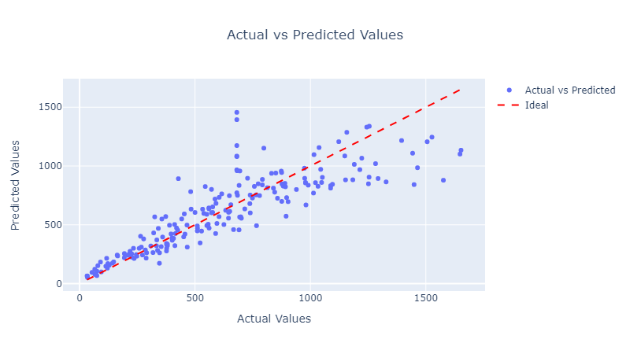

## Dynamic Pricing Prediction Model

A machine learning model (Random Forest & Huber Regressor) that predicts dynamic ride prices based on rider demand, driver supply, vehicle type, and expected ride duration.

### Metrics (Random Forest Regressor)
1. **R2 Score:** `0.7346`
2. **Mean Absolute Error:** `131.8321`
3. **Root Mean Squared Error:** `192.0081`
4. **Explained Variance Score:** `0.7370`

### Setup
```bash
pip install -r requirements.txt
jupyter notebook model.ipynb
```

</img>